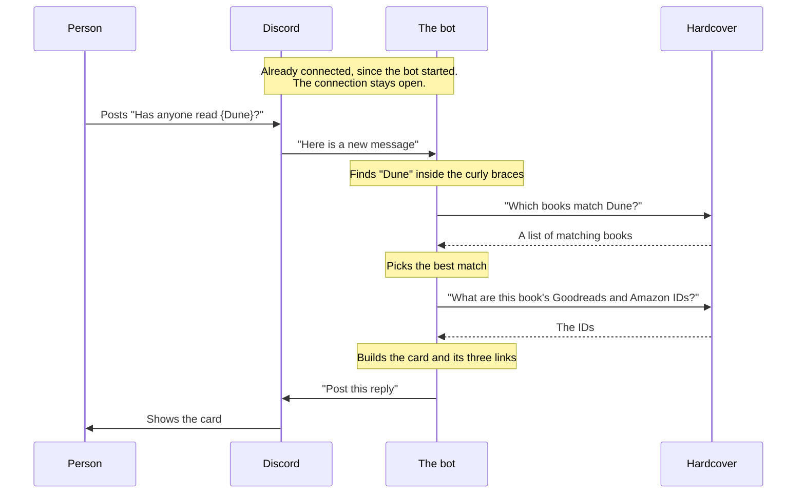
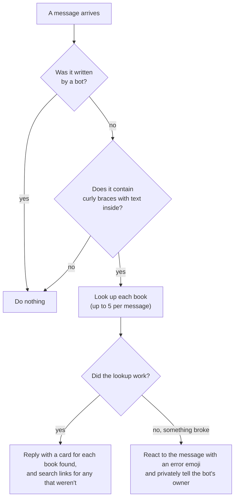
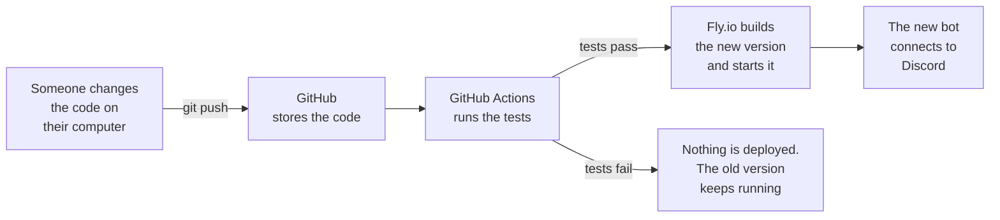

# How the book bot works

A tour of the bot for someone new to programming. It explains what the bot is, what
happens when someone posts `{Dune}`, where each part lives in the code, and how the bot
ends up running on the internet. You don't need to know Python to follow it.

For step-by-step setup instructions, see [SETUP.md](SETUP.md).

## The short version

The bot is one small program that runs all day on a rented computer. It stays connected
to Discord, and Discord tells it about every new message in the channels it can see. The
bot ignores almost all of them. When a message contains something in `{curly braces}`,
the bot asks a book website called Hardcover about it, and posts what it learns as a
reply.

Three parties are involved:

- **Discord**: where people chat, and where the bot's replies appear.
- **The bot**: the program in this repository.
- **Hardcover**: a book-tracking website, like Goodreads. It has a catalog of books that
  programs are allowed to search.

## What happens when someone posts `{Dune}`



The whole exchange usually takes a second or two.

### 1. The bot keeps a connection open to Discord

Most of the web works by asking: your browser asks a website for a page, gets it, and the
conversation is over. A chat bot can't work that way, because it would have to keep
asking Discord "any new messages? any new messages?" all day.

So when the bot starts, it makes one connection to Discord and leaves it open, like a
phone call that never hangs up. Whenever something happens, Discord sends a short note
down that connection: "a message was posted", "someone clicked a button". Programmers
call these notes **events**, and this kind of always-open connection a **WebSocket**.

Because the connection has to stay open, the bot has to be running all the time. That is
why it lives on a rented computer rather than on someone's laptop.

### 2. Discord tells the bot about a message

When anyone posts in a channel the bot can see, Discord sends the bot an event containing
the message's text, who wrote it and where.

If you have used JavaScript, this is the same idea as `addEventListener`: you write a
function and it gets called whenever the thing happens. In this bot the function is
called `on_message`, and it is in `bookbot/bot.py`.

### 3. The bot decides whether to care

Nearly every message has nothing to do with the bot, so the first thing it does is check,
and stop if there is nothing for it to do:



The bot never saves or passes on the messages it ignores. It also skips anything inside
code formatting, so pasting a snippet of code that happens to contain braces doesn't set
it off.

### 4. The bot asks Hardcover

Hardcover offers an **API**: a way for programs, rather than people, to ask a website
questions. The bot sends a question such as "which books match *Dune*?" and Hardcover
sends back a list, with each book's title, author, series, cover picture and more.

To use the API the bot needs a **key**, which works like a password and identifies whose
account is asking. Hardcover limits each key to 5,000 questions a day.

Picking the right book takes some care. Searching for "Dune by Frank Herbert" word for
word tends to return study guides and box sets, and searching "everlasting" returns
obscure books called exactly *Everlasting* ahead of the much better-known *The
Everlasting*. `bookbot/lookup.py` holds the rules the bot uses to choose, and the
[README](../README.md#how-it-finds-a-book) describes them.

### 5. The bot builds the reply

With a book chosen, the bot builds the three links (Hardcover, Goodreads, Amazon) and
lays out the card: title and author, then year and page count, then series and genres,
then the links, with the cover alongside. The title links to the book on Hardcover,
unless Hardcover is missing its cover or blurb; then it goes to Goodreads or Amazon (a
Goodreads search, if the bot doesn't know the book's page on either).

This is the friendliest part of the code to experiment with. It is all in
`bookbot/formatting.py`, which has its own guide at the top. You can see a sample reply
in your web browser, without Discord or any accounts, by running:

```bash
uv run python -m bookbot.preview
```

### 6. The bot sends the reply

The bot hands the finished card to Discord, which shows it as a reply to the original
message. Under it are two buttons: **Wrong book?** and a bin for deleting the reply.

Clicking a button works the same way as posting a message: Discord sends the bot an
event saying who clicked what, and the bot decides how to respond. Only the person who
asked for the book may use the buttons, so the bot checks who clicked first.

### 7. If the message is edited, the reply follows

Discord also sends the bot an event whenever a message is edited. The bot pulls the
`{…}` queries out of the new text and compares them with the ones it answered:

- a message that had none gets a reply now;
- if they changed, the existing reply is edited in place, so it stays where it is and
  nobody is notified again. Only the new queries are looked up; cards for the ones that
  stayed are kept as they are, including a book chosen with **Wrong book?**;
- if they are all gone, the reply is deleted;
- if they are the same, nothing happens. This matters because Discord also reports an
  "edit" when a link preview loads or a message is pinned.

## What the bot remembers

**For an hour, in memory:** the list of other possible matches for each reply, so that
**Wrong book?** opens at once. That list is also lost whenever the bot restarts. After
that, a click on the button makes the bot read the original message again and repeat the
search. It reads which book each card shows now from the card's own link, so a book
chosen earlier stays. The search may not return quite the matches it did the first time.
If the message has been deleted, or its queries no longer line up with the cards, the
button is removed with a note. A `/book` reply has no message to read again, so its
button is removed after 14 minutes.

**In memory, for the last 500 messages it answered:** which queries each had and which
reply it got, so that an edit can update that reply. For a message it no longer
remembers (an older one, or one from before a restart), the bot looks through the
channel for its reply instead and rebuilds it, which loses any **Wrong book?** choice.

**Permanently, in a usage log:** a small SQLite file (`usage.db`) on a Fly volume, so it
survives deploys. It exists so the owner can see which servers use the bot and which
books come up, and it is only written when `USAGE_DB` is set (the development bot leaves
it unset and records nothing). For each book someone asks for, it keeps:

- which server and channel (and the channel's category, and the thread if it was in
  one), and when;
- the title text typed inside the `{…}`, and the Hardcover book it matched. If the asker
  switches books with **Wrong book?**, the record is corrected to the book they chose,
  and if they edit a query out of their message, its record is deleted. A query that
  found nothing is kept too, which is what `/retry-missed` goes by: it searches for those
  again and fills in the record when the book turns up. It also notes whether Hardcover
  had a cover and blurb for the book, so `/retry-missed` can fill those in later;
- whether it was a `{…}` message or `/book`, and the ID of the message (so it can be
  found again, but the text is not kept). A `/book` has no message, so it keeps the ID of
  the bot's reply instead, for `/retry-missed` to fill in a missing cover;
- a label (positive, negative or neutral) and score for the message, from a small
  word-list sentiment checker. It ignores the `{…}` text itself, and every book in one
  message gets the same score;
- a **hash** of the asker, made with a secret salt (`USAGE_SALT`). The same person always
  gets the same hash, so "how many different people asked about this book" works, but the
  hash can't be turned back into a Discord account without the salt.

It does **not** keep the text of any message, anyone's Discord ID or name, or anything
from direct messages or from servers that haven't added the bot (where someone used
`/book` from their own account). It also keeps one row per Hardcover book seen (title, authors,
series, year, pages, genres, popularity), which comes from the lookup that was done anyway.
And for the tip about `{…}` on `/book` replies, it keeps which people (by the same hash)
have been shown it in each server, so each person only sees it once.

Hardcover sometimes has several entries for one book. The log records whichever the bot
matched, and a `book_merges` table (empty to begin with) says "treat book 3 as book 1".
Reports follow it.

If the log can't be opened at startup, or a write fails later, the bot keeps answering and
DMs the owner (at most once an hour per kind of error) instead of going down.

To read the log:

```bash
scripts/stats
```

or DM the bot `/stats`, which sends the same report as Discord messages (owner only).

By default it leaves out the bot's own servers (BookBot test server and BookBot HQ) and
the owner's own lookups. Add `--server NAME_OR_ID` to look at only some servers (any of
them, the bot's own included), or `--exclude NAME_OR_ID` to leave out more; both can be
repeated. `--all-servers` keeps the bot's own servers in, and `--include-owner` or
`--only-owner` the owner's lookups.

That prints the ten most mentioned books (counted by distinct people, as well as mentions),
servers, channels, queries nothing was found for, and pairs of books with the same title
that may be duplicates. To merge a pair, the first book then counts as the second everywhere:

```bash
fly ssh console -C "python -m bookbot.stats merge 3 1"
```

Fly keeps daily snapshots of the volume (see [SETUP.md](SETUP.md)); there is no other
backup.

## Where things are in the code

| File | What it does |
|---|---|
| `bookbot/bot.py` | Talks to Discord: receives events, sends replies, handles button clicks |
| `bookbot/parsing.py` | Finds the `{…}` parts of a message and splits "Title by Author" |
| `bookbot/lookup.py` | Decides which book a query most likely means |
| `bookbot/hardcover.py` | Asks Hardcover's API questions and reads its answers |
| `bookbot/links.py` | Builds the Hardcover, Goodreads and Amazon links |
| `bookbot/formatting.py` | Decides what a reply looks like |
| `bookbot/config.py` | Reads the bot's settings (its keys) |
| `bookbot/usage.py` | Writes the usage log (SQLite) |
| `bookbot/sentiment.py` | Gives a message a positive/negative/neutral label |
| `bookbot/stats.py` | Prints a summary of the usage log |
| `tests/` | Checks that all of the above still behaves as intended |

The tests are small programs that run parts of the bot with made-up input and check the
result. They let you change something and find out within a second whether you broke
something else:

```bash
uv run pytest
```

## Secrets

The bot needs two secret values to work: a **Discord token**, which proves to Discord
that it really is this bot, and the **Hardcover key**. Anyone holding the Discord token
could make the bot say anything, so the secrets are never written in the code or saved
in this repository.

On your own computer they go in a file called `.env`, which git is told to ignore. On
the rented computer they are stored by the hosting company and handed to the bot when it
starts.

## When something goes wrong

- If a lookup fails (say, Hardcover is down), the bot adds an error emoji to the message
  that asked and posts nothing. It also sends a private message to its owner with the
  details.
- Every five minutes the bot pings a monitoring service to say "still here". If the pings
  stop, the service emails the owner. This catches the case where the bot has stopped
  completely and so can't report anything itself.

## How the bot gets onto the internet

The bot runs on a small computer rented from a company called **Fly.io**, which keeps it
switched on and restarts the bot if it crashes. Getting a new version of the code onto
that computer is called **deploying**, and it happens automatically:



1. **GitHub** holds the official copy of the code. Sending your changes there is called
   pushing.
2. **GitHub Actions** is a service that runs commands for you whenever code is pushed.
   Here it runs the tests. The instructions for it are in `.github/workflows/ci.yml`.
3. If the tests pass and the change is on the main branch, it tells Fly.io to deploy.
4. Fly.io packages the bot together with Python and everything else it needs into a
   **Docker image**: a sealed box that runs the same way on any computer. The recipe for
   the box is the `Dockerfile`.
5. Fly.io stops the old bot and starts the new one, which connects to Discord and carries
   on.

While the swap happens the bot is briefly offline, and misses any `{…}` posted in that
moment.

### Two bots, not one

There are two separate bots registered with Discord: the real one, which runs on Fly.io
and lives in the real server, and a development copy for trying things out. You run the
development copy on your own computer, in a private test server, with:

```bash
uv run python -m bookbot
```

That way an experiment can never break the real bot or post nonsense where people will
see it.

## Words you will run into

| Word | Meaning |
|---|---|
| API | A way for programs to ask a website for information |
| Token, key | A password that identifies a program to a service |
| Event | A note from Discord that something happened |
| WebSocket | A connection that stays open so either side can send at any time |
| Embed | Discord's name for a card like the bot's reply |
| Deploy | Put a new version of a program where it runs for real |
| Docker image | A program packaged with everything it needs to run |
| Repository | A project's files and their full history of changes, managed by git |
| Environment variable | A setting given to a program from outside its code; how the secrets get in |
